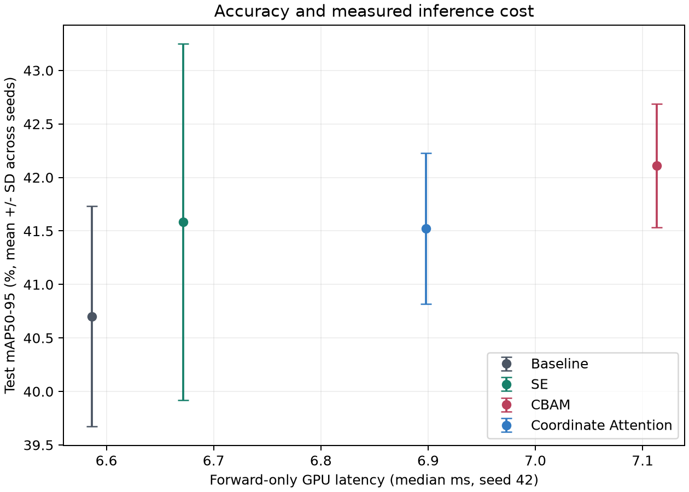

# Attention Mechanisms for Apple Defect Detection

A controlled comparison of YOLOv8n with Squeeze-and-Excitation (SE), Convolutional Block Attention Module (CBAM), and Coordinate Attention on the Surface Subtle Defects Apple (SSDA) dataset.

**Ved Waghela and Manish Gadia** | COMPSCI 764 research project | University of Auckland

## Main finding

CBAM achieved the highest mean test mAP50-95 in this configuration: **42.11%**, compared with **40.70%** for the baseline, at approximately **8% higher forward-only GPU latency**. These are descriptive findings from three seeds on one split, not evidence of universal superiority or statistical significance.

| Model | Test mAP50 (%) | Test mAP50-95 (%) | Forward median (ms) |
| :--- | ---: | ---: | ---: |
| YOLOv8n | 75.54 +/- 1.92 | 40.70 +/- 1.03 | 6.586 |
| + SE | 76.80 +/- 1.37 | 41.58 +/- 1.66 | 6.671 |
| + CBAM | 76.68 +/- 0.93 | 42.11 +/- 0.58 | 7.113 |
| + Coordinate Attention | 76.83 +/- 1.22 | 41.52 +/- 0.70 | 6.898 |

Values after +/- are sample standard deviations across seeds 42, 43 and 44. Timing uses seed-42 checkpoints, FP32, batch 1, 640-pixel input and an RTX 2050; it excludes preprocessing, transfers and NMS.



## Project contents

| Folder | Contents |
| :--- | :--- |
| `baseline/` | Original experiment code and frozen methodology |
| `data/splits/` | Portable frozen split metadata; no dataset images |
| `results/records/` | Final evaluation, plots, diagnostics and 12 training histories |
| `reports/` | Final polished Word report |
| `scripts/` | Local-path setup helper |
| `docs/` | Reproduction, attribution and publication notes |

Start with the [full results](results/records/final_evaluation/RESULTS.md), [frozen protocol](baseline/FINAL_PROTOCOL.md), [architecture details](baseline/ATTENTION.md), and [reproduction guide](docs/REPRODUCING.md).

## Experimental design

- One attention module after backbone C2f layer 6 (stride 16), with the same pretrained YOLOv8n initialization.
- Four models, three matched seeds, 50 epochs per run; validation-selected checkpoints.
- SSDA: 710 images, 1,512 defect boxes; grouped split of 500 training, 106 validation and 104 test images.
- Class-specific AP, forward latency, training curves, fixed-threshold diagnostics and a qualitative failure case.
- No healthy negatives, orchard robustness tests or verified physical-apple identity grouping. The inferred class-ID mapping and annotation correction are documented in the report.

The test set has already been evaluated. Do not tune the models on these test outcomes.

## Getting started

Python 3.13.5 was used for the original experiments. Create an isolated environment and install PyTorch appropriate for your hardware. For the original CUDA 12.8 setup:

```powershell
python -m venv .venv
.venv\Scripts\Activate.ps1
python -m pip install torch==2.8.0 torchvision==0.23.0 --index-url https://download.pytorch.org/whl/cu128
python -m pip install -r requirements.txt
python scripts/setup_local.py
python baseline/evaluate_study.py --self-test
python baseline/summarize_study.py
```

The last command recomputes plots and aggregates from saved results, without training or downloading data. Full training requires the external dataset and pretrained weights; see [REPRODUCING.md](docs/REPRODUCING.md).

## Data and checkpoints

Dataset images, trained weights, Python environments, caches, obsolete drafts and course handouts are intentionally excluded. This is a lightweight source-and-results repository, **not** the full private backup. Dataset access and attribution are documented in [THIRD_PARTY.md](docs/THIRD_PARTY.md). Trained checkpoints remain in the private project archive and are not hosted here.

## Authors and assistance

Ved Waghela led the project, experimental work and report preparation. Manish Gadia contributed background literature research. Generative AI assisted with implementation, execution support, analysis preparation and draft development. The authors are responsible for the reported methods and interpretations.

## Publication and reuse

No new blanket software license is assigned by this packaging step. Third-party components retain their own terms. Review [publication notes](docs/PUBLISHING.md) before making the repository public, including coauthor agreement and course rules. This package contains no Git history, credentials or configured remote.
